  

  
  
  
  

Card redrawn daily by <a href="profile.py">profile.py</a>. Cat from <a href="https://giphy.com/stickers/XIjw2n4kUXxuqDn7dN">GIPHY</a>, pixelated in Python. Font: BoldPixels by <a href="https://yukipixels.itch.io/">Yūki</a> (<a href="https://www.instagram.com/yukipixels">@YukiPixels</a>), CC BY-SA 4.0.
